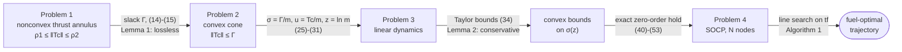
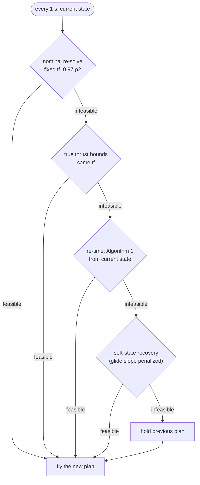
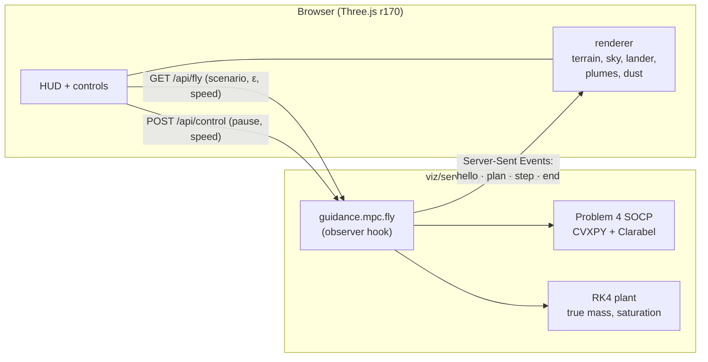

<div align="center">

# Powered Descent Guidance

### Lossless convexification for Mars pinpoint landing — rebuilt from the papers, verified against the theory, measured like flight software, and flown live in 3-D


<br>


<sub>Touchdown in the live simulation: the convex guidance below flew this landing in real time (landing error and speed in the table further down are from the same code).</sub>

**[▶ Open the 3-D simulation in your browser](https://beriltatli.github.io/powered-descent/)** · recorded flights; `make viz` for live solves ([section 10](#10-live-3-d-simulation))

</div>

---

**What this is.** A complete, from-the-source implementation of the powered-descent guidance algorithm of
**Açıkmeşe & Ploen (2007)**. The problem is to choose the thrust profile that lands a rocket on Mars at a chosen point, softly, with as
little fuel as possible, while the engines can neither exceed their maximum nor drop below a minimum
throttle. That lower bound makes the problem nonconvex. The paper's *lossless convexification* turns it into
a second-order cone program (SOCP) that a solver handles reliably in milliseconds, and proves that nothing
is lost doing so.

This repository:

1. **implements** the algorithm in CVXPY, DPP-compliant;
2. **verifies** every claim of the theory numerically;
3. **measures** it like flight software (latency tails, recursive feasibility);
4. **flies** it in closed loop against a ±5 % mass-estimation error, with Monte Carlo statistics and baselines;
5. **tests** the hypotheses of the 2013 pointing-constraint result;
6. **runs** the very same guidance code live inside a photoreal Three.js Mars scene.

Every number in this README and in [REPORT.md](REPORT.md) is rendered from `results/*.json`. The test suite
fails if either document disagrees with the results.

## Contents

- [Key results](#key-results)
- [1. The problem](#1-the-problem)
- [2. The method: from a nonconvex problem to an SOCP](#2-the-method-from-a-nonconvex-problem-to-an-socp)
- [3. What was built, phase by phase](#3-what-was-built-phase-by-phase)
- [4. Verification against the theory](#4-verification-against-the-theory)
- [5. Fuel convergence and solve-time tail](#5-fuel-convergence-and-solve-time-tail)
- [6. Closed-loop guidance under mass error](#6-closed-loop-guidance-under-mass-error)
- [7. Baselines](#7-baselines)
- [8. The landable envelope](#8-the-landable-envelope)
- [9. The pointing constraint and the 2013 hypotheses](#9-the-pointing-constraint-and-the-2013-hypotheses)
- [10. Live 3-D simulation](#10-live-3-d-simulation)
- [11. Repository layout](#11-repository-layout)
- [12. Running and reproducing](#12-running-and-reproducing)
- [13. Choices not taken from the papers](#13-choices-not-taken-from-the-papers)
- [14. Limitations and what was missed](#14-limitations-and-what-was-missed)
- [15. Sources and credits](#15-sources-and-credits)
- [16. License](#16-license)

## Key results

Hardware for every timing: **${hw}**, Python ${py}, CVXPY ${cvxpy}, Clarabel ${clarabel}.

| Brief's success criterion | Target | Result | |
|:--|:--|:--|:--:|
| Per-solve latency, p99, compile reported separately | < 50 ms | **${tm_p99} ms** at N = ${N} over ${tm_n} solves (compile ${compile_ms} ms) | ✅ |
| Landings within 5 m, ${mc_runs} runs, ε ~ U[−5 %, +5 %] | ≥ 95 % | **${closed_within_radius}** | ✅ |
| Touchdown below 1 m/s, same runs | ≥ 95 % | **${closed_below_speed}** | ✅ |
| Recursive feasibility | > 99 % | **${rf_res}** of ${rf_total} re-solves | ✅ |
| Lemma 1: slack tight on ${bat_n} random instances | every violation characterized | ${bat_loose} loose node, characterized (solver residual) | ✅ |
| Discretization matches continuous propagation | 1e-9 | met | ✅ |
| Convex optimum ≥ best of ${nc_starts} nonconvex starts, ${nc_n} instances | all | ${nc_t_ok}/${nc_n} vs Taylor-bounded Problem 1; **missed** vs exact (32): ${nc_e_beaten}/${nc_n} beaten by ≤ ${nc_e_gap} % | ⚠️ |
| 2013 pointing hypotheses stated | stated | from a **secondary source** (the 2013 paper itself was not available) | ⚠️ |

```mermaid
xychart-beta
    title "Soft pinpoint landings (within 5 m AND below 1 m/s), ${mc_runs} runs, ±5 % mass error"
    x-axis ["Constant T/W", "Polynomial (Apollo-style)", "Open-loop optimum", "Convex MPC (this repo)"]
    y-axis "Success rate (%)" 0 --> 100
    bar [${constant_tw_success_num}, ${polynomial_success_num}, ${open_loop_success_num}, ${closed_success_num}]
```

| Method (ε ~ U[−5 %, +5 %]) | Mean fuel (kg) | Within 5 m | Below 1 m/s |
|:--|--:|--:|--:|
| Constant thrust-to-weight gravity turn | ${constant_tw_fuel_mean} | ${constant_tw_within_radius} | ${constant_tw_below_speed} |
| Polynomial (Apollo-style), engine-saturated | ${polynomial_fuel_mean} | ${polynomial_within_radius} | ${polynomial_below_speed} |
| Open-loop convex optimum, flown blind | ${open_loop_fuel_mean} | ${open_loop_within_radius} | ${open_loop_below_speed} |
| **Convex MPC, re-solved every second** | **${closed_fuel_mean}** | **${closed_within_radius}** | **${closed_below_speed}** |

## 1. The problem

A lander starts its powered descent at a known position $$r_0$$ and velocity $$\dot r_0$$ (here 1.5 km up and
2 km downrange) and must reach the target at rest. Following the paper, the surface-fixed frame has its first
axis along altitude; Mars gravity is constant. The vehicle is a point mass:

```math
\ddot r(t) = g + \frac{T_c(t)}{m(t)}, \qquad \dot m(t) = -\alpha \,\lVert T_c(t)\rVert, \qquad \alpha = \frac{1}{I_{sp}\, g_e \cos\phi}
```

Six throttleable engines, canted by $$\phi$$ = 27°, give a thrust magnitude that must stay inside an **annulus**:

```math
0 < \rho_1 \le \lVert T_c(t) \rVert \le \rho_2 \qquad (\rho_1 = ${rho1}\ \text{N},\ \rho_2 = ${rho2}\ \text{N})
```

The lower bound exists because the engines cannot be throttled below 30 % once lit. It makes the set of
admissible thrust vectors a hollow shell, which is **nonconvex**. A general nonlinear solver may then fail,
converge to a local optimum, or take unpredictable time, none of which is acceptable during the ~70 s of a
real descent. Further constraints: no flight below the surface, a **glide-slope cone** (86° from vertical)
that keeps the vehicle away from terrain, a speed bound, and a fixed final thrust direction.
The objective is minimum fuel, $$\min \int_0^{t_f} \lVert T_c \rVert\, dt$$.

## 2. The method: from a nonconvex problem to an SOCP



| Step | Paper reference | What it does |
|:--|:--|:--|
| Slack relaxation | (14)–(15), **Lemma 1** | Replace $$\lVert T_c\rVert$$ by a slack $$\Gamma$$ with $$\lVert T_c\rVert \le \Gamma$$, $$\rho_1 \le \Gamma \le \rho_2$$. Lemma 1 proves $$\lVert T_c\rVert = \Gamma$$ at the optimum (Pontryagin maximum principle), so the relaxation is exact. |
| Change of variables | (25)–(31) | $$\sigma = \Gamma/m$$, $$u = T_c/m$$, $$z = \ln m$$ make the dynamics linear: $$\ddot r = g + u$$, $$\dot z = -\alpha\sigma$$. |
| Taylor bounds | (33)–(36), **Lemma 2** | The bound $$\rho_1 e^{-z} \le \sigma \le \rho_2 e^{-z}$$ is replaced by a convex quadratic lower and a linear upper bound around $$z_0(t) = \ln(m_{wet} - \alpha\rho_2 t)$$; Lemma 2 proves them conservative. |
| Discretization | (40)–(53) | Exact zero-order hold via one matrix exponential (Van Loan), giving Problem 4, an SOCP. |
| Time of flight | (54)–(58), **Algorithm 1**, Remark 10 | Line search over $$t_f$$ between the bounds (55); the fuel cost is unimodal in $$t_f$$. |

The relaxed lower Taylor bound used at node $$k$$, with $$\mu_1 = \rho_1 e^{-z_0}$$:

```math
\mu_1(t_k)\left[1 - (z_k - z_0(t_k)) + \tfrac{1}{2}(z_k - z_0(t_k))^2\right] \le \sigma_k \le \mu_2(t_k)\left[1 - (z_k - z_0(t_k))\right]
```

**One deliberate deviation, argued in [THEORY.md §6](THEORY.md).** The paper fixes Δt and searches over N.
Here N is fixed at compile time and **Δt = tf / N is a `cvxpy.Parameter`**. Every quantity that changes between solves is a parameter:

- the initial state;
- the ZOH matrices;
- the Taylor coefficients;
- the per-node pointing γ.

One compiled problem therefore serves every tf and every initial state (`assert prob.is_dpp()`). It is the same search over tf. It makes the latency numbers honest and lets the closed loop shrink Δt as time-to-go shrinks.

## 3. What was built, phase by phase

Each phase ended with `make check` green and one local commit.

| Phase | What | Where |
|:--:|:--|:--|
| 1 | Environment with exact pins, `config.yaml` with a page/equation citation for every value, theory notes read from the PDF | `config.yaml`, `THEORY.md` |
| 2 | Frame, continuous dynamics, exact ZOH discretization (augmented matrix exponential) | `dynamics/` |
| 3 | Problem 4 with DPP parameters; the losslessness verification battery (slack, bang-bang, (32), (13), inter-node) | `problem/`, `verify/` |
| 4 | Free-final-time search (Algorithm 1), infeasibility classes, unimodality, nonconvex multistart comparison, pointing-constraint gap | `tof/`, `nonconvex/`, `pointing/` |
| 5 | Fuel convergence vs N, solve-time tail over ≥ 500 solves, three baselines | `metrics/`, `baselines/` |
| 6 | Closed-loop MPC under mass error, 1000-run Monte Carlo, ablations, landable envelope | `guidance/`, `montecarlo/` |
| 7 | Report rendered from results, with a test that fails on any disagreement | `REPORT.md`, `scripts/report.py` |
| + | Hypotheses of the 2013 pointing result, checked on this model, with a rotating-planet experiment | `verify/lcvx_conditions.py` |
| + | Live 3-D simulation running the same guidance code in real time | `viz/` |

## 4. Verification against the theory

On **${bat_n} random feasible instances** (${bat_draws} draws: ${bat_valid} valid, ${bat_fuel} insufficient fuel, ${bat_thrust} insufficient thrust; none dropped):

| Claim | Test | Result |
|:--|:--|:--|
| Exact discretization | ZOH vs `solve_ivp` | < 1e-9 relative |
| **Lemma 1** — slack tight | $$\sigma_k - \lVert u_k\rVert$$ at every node | ${bat_loose} loose node of all instances (#${bat_loose_i}); re-solved at 1e-10 tolerance it is tight to ${bat_loose_tight}: a solver residual |
| **Lemma 1** — bang-bang thrust | Γ on its bounds except at explained nodes | ${bb_switch} switch nodes, **${bb_unexplained} unexplained** |
| **Lemma 2** — exact bound (32) | at every node | holds at all nodes; between nodes it dips by up to ${bat_e32_end_abs} N (ZOH, characterized) |
| Mass equation (13) tight | fuel booked vs burned | max difference ${bat_mass13} kg |
| Glide slope between nodes | continuous trajectory inside each interval | worst ${bat_gs_max} m outside the cone between nodes |
| **Remark 10** — unimodal in tf | dense tf sweep | ${tof_rand_uni} of ${tof_rand} instances unimodal |
| Global optimality vs nonconvex | SLSQP, ${nc_starts} starts × ${nc_n} instances | convex ≤ best start on ${nc_t_ok}/${nc_n} (Taylor bounds); vs exact (32), beaten on ${nc_e_beaten}/${nc_n} by ≤ ${nc_e_gap} % — Lemma 2's conservatism, not a losslessness failure |

<p align="center">
  
  
</p>
<p align="center">
  
  
</p>

**Reproduction of the paper:** at N = ${N} the Section V case gives tf = ${nom_tf} s and ${nom_fuel} kg (paper, Fig. 7: 81 s, 399.5 kg).
**Finding:** the paper's own example carries 400 kg of fuel and needs ${cv_sv_fuel_N} kg at N = ${N}, so Algorithm 1 classifies it as *insufficient fuel*. It first becomes valid at N = ${cv_first_valid}, where the p99 solve time is ${cv_first_valid_p99} ms, over budget. The Monte Carlo therefore uses a nearby state with margin, and also flies the paper's state as given.

## 5. Fuel convergence and solve-time tail

| N | Section V fuel (kg) | Section V class | MC-state fuel (kg) | p50 ms | p99 ms |
|--:|--:|:--|--:|--:|--:|
${cv_table}

At N = ${N} the fuel gap to N = ${cv_ref} is ${cv_mc_gap} kg (${cv_mc_gap_pct} %).

| Per solve, ${tm_n} solves, N = ${N}, ${hw} | p50 | p95 | p99 | max |
|:--|--:|--:|--:|--:|
| Wall time of the whole `solve()` call (ms) | ${tm_p50} | ${tm_p95} | **${tm_p99}** | ${tm_max} |

- **Compile, paid once:** ${compile_ms} ms.
- **DPP re-solve:** ${dpp_p50} ms p50, against ${rc_p50} ms when recompiling on every call.

<p align="center">
  
  
</p>

## 6. Closed-loop guidance under mass error

**Setup.** The guidance believes the mass is $$\hat m = (1+\varepsilon)\, m$$ and commands $$T_c = u\,\hat m$$, with $$\varepsilon \sim U[-5\,\%, +5\,\%]$$ held for the whole flight. The vehicle therefore accelerates $$(1+\varepsilon)$$ times harder than planned.

**Loop.** Every second, Problem 4 is re-solved from the true current state with the landing time held fixed (shrinking horizon). Re-solving stops 0.25 s before touchdown. The plant is the true point-mass dynamics, integrated with RK4, with saturation and fuel exhaustion.



| ${mc_runs} runs, state r0 = ${mc_r0} m, v0 = ${mc_v0} m/s | Value |
|:--|--:|
| Landing error p50 / p95 / max | ${closed_landing_error_p50} / ${closed_landing_error_p95} / ${closed_landing_error_max} m |
| Touchdown speed p50 / p95 / max | ${closed_touchdown_speed_p50} / ${closed_touchdown_speed_p95} / ${closed_touchdown_speed_max} m/s |
| Within 5 m / below 1 m/s | **${closed_within_radius}** / **${closed_below_speed}** |
| Fuel mean / p95 (400 kg on board) | ${closed_fuel_mean} / ${closed_fuel_p95} kg |
| Recursive feasibility (hard problem, some tf) | ${rf_res} of re-solves, ${rf_runs} of runs |
| Strict (feasible at the original landing time) | ${strict_res} of re-solves, ${strict_runs} of runs |
| Runs that ran out of fuel | ${closed_exhausted} |

**Ablations.** Each design choice was switched off in turn, on the same mass-error samples:

| Design choice (not in the paper) | Why | Switched off |
|:--|:--|:--|
| Plan with the heaviest plausible mass (margin ${mc_margin} %) | ε < 0 makes every planned acceleration fall short | success drops to ${ab_nm_success} (first ${ab_n} samples) |
| Plan with 0.97 ρ2, fall back to the true ρ2 | keeps headroom for the final full-thrust burn | ${tightening_sentence} |
| Stop re-solving 0.25 s before touchdown | late re-solves on a vanishing horizon are ill-conditioned | with a 1 s cutoff, ${ab_ts_below} land below 1 m/s |

**Failure mechanism.** Every closed-loop failure is fuel exhaustion after a run of re-timings. Problem 4 has no fuel constraint (Remark 8), and the guidance's fuel belief is off by the same ε as its mass belief.

**The paper's own Section V state** was flown the same way: ${section_v_closed_exhausted} of ${mc_runs} runs ran out of fuel.

<p align="center"></p>

## 7. Baselines

| Baseline | Idea | Outcome under ±5 % mass error |
|:--|:--|:--|
| Open loop | the same convex optimum, solved once and flown blind | ${open_loop_within_radius} within 5 m: re-solving is what makes it work |
| Polynomial (Apollo-style) | $$a = -6r/t_{go}^2 - 4\dot r/t_{go} - g$$ | commands thrust outside the annulus in ${poly_outside_runs} of runs; with a real engine it hits the ground; with an *ideal* engine it lands, spending ${polyi_outside} of the flight outside [ρ1, ρ2] |
| Constant thrust-to-weight | gravity turn, calibrated once | ${constant_tw_within_radius} within 5 m: fuel-cheap, but it does not aim |

## 8. The landable envelope

The envelope is mapped over initial downrange position × initial horizontal velocity (${env_grid} grid). A cell counts as landable with error only if the closed loop succeeds at both ε = −5 % and ε = +5 %.

**${env_sentence}**

<p align="center"></p>

## 9. The pointing constraint and the 2013 hypotheses

**What the 2007 paper admits.** Section VI of the 2007 paper states that a thrust-pointing cone breaks the losslessness argument. The cone constraint (61) is $$v^\top u \ge \gamma\, \sigma$$. On the paper's 5 km hover-start example the slack goes loose, meaning the commanded thrust falls below ρ1.

**Over ${pt_n} random high, slow starts:**

| Cone | Formulation | Instances with material loose slack |
|:--|:--|--:|
| 90° (paper) | no pointing | ${pt_90deg_off_mat} |
| 90° | (61) exact | ${pt_90deg_exact61_mat} |
| 45° | (61) exact | ${pt_45deg_exact61_mat} |
| 45° | paper's heuristic (62) | ${pt_45deg_heuristic62_mat} (and pointing violated on ${pt_45deg_heuristic62_viol}, up to ${pt_45deg_maxviol}°) |

**The 2013 result** (Açıkmeşe, Carson & Blackmore, IEEE TCST) was not available as a PDF. Its theorem is stated from the tutorial by Malyuta et al. (2022), whose Theorem 2 cites it, so this is a **secondary source**; the exact statements are in [THEORY.md §8](THEORY.md). The relaxation is the same half-space as (61). What 2013 adds are hypotheses, and this repository checks them on its own model:

| Hypothesis (tutorial numbering) | This model |
|:--|:--|
| Condition 1: {A, B} controllable | ✅ holds |
| Condition 2: transversality, σ(tf) ≠ 0 | ✅ holds on every solve, guaranteed by (51) |
| Condition 3: {A, BN} controllable (N ⟂ cone axis) | ❌ **fails**: no planet rotation in the 2007 model, rank ${lc_c3_rank} of 6 |
| Glide-slope test (106), 45° cone | ✅ holds |
| Glide-slope test (106), 90° cone | ❌ fails by ${lc_fb90} N |

**Experiment: add planet rotation so that Condition 3 holds.** The same instances were re-solved with rotation in the dynamics:

| Rotation | 90° cone, loose | 45° cone, loose |
|:--|--:|--:|
| none (2007 model) | ${lc_none_2007_90deg_mat} | ${lc_none_2007_45deg_mat} |
| Mars, tutorial value (Condition 3 holds barely) | ${lc_mars_tutorial_90deg_mat} | ${lc_mars_tutorial_45deg_mat} |
| 100× exaggerated (diagnostic) | ${lc_diagnostic_x100_90deg_mat} | ${lc_diagnostic_x100_45deg_mat} |

**What it shows:**

- With real Mars rotation, satisfying Condition 3 changes nothing measurable: the coupling is |ω|·tf = ${lc_wt} rad.
- Exaggerated 100×, the loose cases drop but do not vanish.
- The theorem is a continuous-time statement and gives no guarantee after discretization.

<p align="center"></p>

## 10. Live 3-D simulation

`make viz` starts a local server; open **http://127.0.0.1:8765/**. The browser does **not** replay a recording. The server runs the guidance *during* the flight and streams each re-solve and each plant step to the browser:

- the Python guidance `guidance.mpc.fly` itself;
- Problem 4, the SOCP, solved by Clarabel every second;
- the same fallback chain, mass-error model and RK4 plant as the Monte Carlo.

**Online version: [beriltatli.github.io/powered-descent](https://beriltatli.github.io/powered-descent/).** GitHub Pages serves static files only, so there is no solver there. When the page finds no server, it replays flights that `viz/record.py` recorded from this same server code: every plan and re-solve, with plant steps at 20 Hz of sim time. There is one recording per mass error on the slider (−5 % to +5 %), for the Monte Carlo start, the Section V start and four random starts, and the solve times shown are from the recording machine. `make record` regenerates them.

<table>
<tr>
<td width="50%"><br><sub><b>Chase camera</b>, high altitude. Left: telemetry, with the throttle bar showing the 30–80 % engine band. Right: last plan, live solve time against the 50 ms budget, and fallback log.</sub></td>
<td width="50%"><br><sub><b>Overview</b>. Cream: the trajectory actually flown. Dashed teal: the latest convex plan. Rings: the 86° glide-slope cone.</sub></td>
</tr>
<tr>
<td width="50%"><br><sub><b>Tracking camera</b>: a telephoto on the ground following the lander through the last 100 m, with nearly transparent hydrazine plumes.</sub></td>
<td width="50%"><br><sub><b>Touchdown summary</b>, from the server's end-of-flight message: landing error, touchdown speed, fuel, re-solves, solve-time p50/max, recursive feasibility.</sub></td>
</tr>
</table>



**It is the same algorithm, verified.** The observer hook only reads (`tests/test_guidance.py::test_observer_only_reads`). The Monte Carlo state at ε = +3 %, flown through the web server and through the Monte Carlo harness, gives identical landing error, touchdown speed, fuel and re-solve counts, to the last printed digit.

| Component | Built from |
|:--|:--|
| Lander | Procedural model matching `config.yaml`: 6 engines canted 27°, hexagonal deck, MLI blankets, propellant spheres, crushable legs; nozzles heat up and cool with a thermal lag |
| Plumes | Custom shader: monopropellant hydrazine in ~600 Pa CO₂ is nearly transparent, a faint glow at the exit, under-expanded spread |
| Terrain | Analytic height field (plains, dunes, power-law crater population, distant mesas and crater walls); kept below the glide-slope cone everywhere within 7 km, flat at the target; CC0 PBR textures tinted to Mars albedo |
| Sky | Custom shader: butterscotch dusty sky with a bluish aureole around the sun, exponential haze |
| Dust | 20k-particle GPU system: radial sheet and billowing cloud where each nozzle's exhaust meets the ground |
| Cameras | Auto (chase high, ground telephoto low), chase, tracking, pad, overview, free orbit |

**What is visual only:**

- The model is 3-DoF, so attitude is the thrust direction with a finite slew rate.
- The guidance sees a flat surface plus the glide-slope cone. Terrain, rocks, dust and the tip-over after a hard impact are scenery.

## 11. Repository layout

```
dynamics/      frame, continuous model, exact ZOH (Van Loan)
problem/       Problem 4 (CVXPY, DPP), Taylor coefficients, config → problem
tof/           Algorithm 1, tf bounds (55), unimodality sweep
verify/        slack / bang-bang / (32) / inter-node checks, 2013 hypotheses
nonconvex/     Problem 1 by SLSQP multistart (Taylor and exact bounds)
pointing/      constraint (61), Section VI heuristic (62)
guidance/      closed-loop MPC, plant (RK4, saturation, fuel exhaustion)
baselines/     open loop, polynomial (Apollo-style), constant T/W
montecarlo/    sampling and parallel harness
metrics/       percentiles, dispersion summaries
scripts/       one script per result + report.py (renders REPORT.md and README.md)
results/       every number, as JSON          figures/   every plot
tests/         ${n_tests} tests, incl. report/README ↔ results agreement
viz/           3-D simulation: server.py (live), record.py → flights/ (Pages replay), js/, css/, assets/ (CC0), vendor/three (MIT)
refs/          README.md: where to get the source papers (the PDFs are not distributed)
THEORY.md      the derivation, with equation numbers, read from the PDFs
REPORT.md      full results, rendered from results/
```

## 12. Running and reproducing

```bash
python3.12 -m venv .venv && .venv/bin/pip install -r requirements.txt   # exact pins

make check       # ${n_tests} tests: dynamics, problem, tf search, guidance, 2013 conditions, report/README agreement
make viz         # live 3-D simulation at http://127.0.0.1:8765/
make record      # re-record the flights the GitHub Pages version replays
make reproduce   # regenerate every results/*.json, figure, REPORT.md and README.md (about 2 h on an M3)
```

`scripts/reproduce.py` runs the timing benchmark first and alone, then every experiment in dependency order. Seeds are fixed in `config.yaml`.

## 13. Choices not taken from the papers

Every value that is not in a paper is marked `# NOT IN PAPER — chosen because …` in [config.yaml](config.yaml). The main ones:

| Choice | Value | Reason |
|:--|:--|:--|
| Node count and step | N = ${N}, Δt = tf/N as a parameter | the paper never states Δt; latency budget (section 5) |
| Solver | Clarabel (ECOS cross-check on error) | the paper used SeDuMi |
| Monte Carlo state | Section V position, horizontal velocity halved | the Section V state has no fuel margin |
| Planning mass margin, 0.97 ρ2 tightening, fallback order, 0.25 s cutoff | see section 6 | each one measured with an ablation |
| Speed bound | 150 m/s | never active in these scenarios |

## 14. Limitations and what was missed

**Missed:**

- **The 2013 paper was never available.** Its hypotheses come from a secondary source.
- **Convex vs exact (32):** SLSQP beats the convex optimum by ≤ ${nc_e_gap} % on ${nc_e_beaten}/${nc_n} instances. This is the cost of Lemma 2's conservative bounds.

**Modelling limits:**

- 3-DoF point mass: there are no attitude dynamics, engine lag or throttle-rate limit.
- Constant gravity, flat surface, no aerodynamics or wind.
- Perfect navigation except mass; the mass error is a constant bias.
- Fuel is not a constraint of the guidance problem, which is the mechanism of every closed-loop failure.

**Timing:** timings are on a laptop CPU through CVXPY. A flight computer with a custom solver would differ.

**Live view:** the frame rate was not benchmarked. The terrain is about 6.8 M triangles and needs a desktop-class GPU.

## 15. Sources and credits

**Papers** (not distributed here, being under their publishers' copyright; [refs/README.md](refs/README.md) says where to get them):

- B. Açıkmeşe, S. R. Ploen, *Convex Programming Approach to Powered Descent Guidance for Mars Landing*, JGCD 30(5), 2007, doi:10.2514/1.27553 — the specification of this repository.
- B. Açıkmeşe, J. M. Carson III, L. Blackmore, *Lossless Convexification of Nonconvex Control Bound and Pointing Constraints of the Soft Landing Optimal Control Problem*, IEEE TCST 21(6), 2013, doi:10.1109/tcst.2012.2237346 — not available here; stated via the next item.
- D. Malyuta, T. P. Reynolds, M. Szmuk, T. Lew, R. Bonalli, M. Pavone, B. Açıkmeşe, *Convex Optimization for Trajectory Generation*, arXiv:2106.09125.
- J. M. Carson III, B. Açıkmeşe, L. Blackmore, *Powered Descent Guidance With General Thrust-Pointing Constraints*, NASA Tech Briefs, Feb. 2013.

**Software and assets:**

- [CVXPY](https://www.cvxpy.org), [Clarabel](https://clarabel.org), ECOS, NumPy, SciPy, Matplotlib.
- [three.js](https://threejs.org) (MIT).
- Terrain textures and rock models from [Poly Haven](https://polyhaven.com) (CC0); foil texture from [ambientCG](https://ambientcg.com) (CC0). See [viz/assets/CREDITS.md](viz/assets/CREDITS.md).

## 16. License

**Personal Use Only License** — see [LICENSE](LICENSE).

- **Allowed:** individuals may download, run, study and modify the code for private, non-commercial use.
- **Not allowed:**
  - use by or for any organization (companies, universities, schools, government bodies, non-profits);
  - commercial use;
  - use in advertising or promotion;
  - redistribution;
  - use as machine-learning training data.
- **Contributions:** issues, discussions and pull requests are welcome.
- **Third-party components** keep their own licenses.
- **Not for operational use:** this is a research simulation. It is not certified for controlling any real vehicle.

<div align="center"><sub>Generated from <code>scripts/readme_template.md</code> by <code>scripts/report.py</code>. Do not edit README.md by hand.</sub></div>
